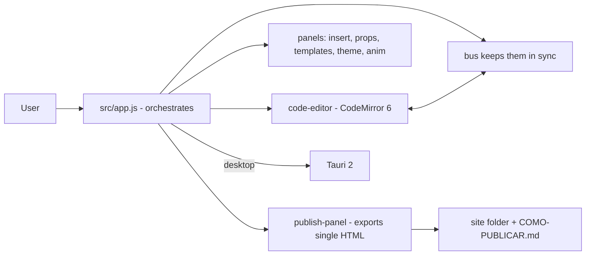

# olaria

**English** · [Português (Brasil)](README.md)

[](#) [](#) [](#) [](#) [](#) [](LICENSE)

## What it is

**Olaria** is a **landing-page builder** for **non-technical** people: build a page visually (click, drag, edit the text) and see the same document as code. The output is **a single HTML file**, ready to publish on GitHub Pages. It is a desktop app (Tauri) whose interface also runs in the browser in test mode.

> Note: the previous README described a **finance dashboard** (Recharts, AI assistant) — it does not exist in this repository. Corrected.

## Status

In production, version **0.3.0** (compiled and tested). Ships a desktop binary (Releases). Web build and tests validated by the agent.

## Features

- **4 views of the same document**: Edit (canvas), Preview (what visitors see), Code and Split (canvas + editor).
- **Visual editing**: click to select, drag to move, double-click to edit text, properties panel on the right.
- **Code editor**: CodeMirror 6 (HTML/CSS/JS), always in sync with the canvas.
- **Block insertion**: insert panel and page templates.
- **Theme and animation**: theme and animation panels.
- **Publishing**: exports a **single HTML file** and generates a site folder with `COMO-PUBLICAR.md` (for GitHub Pages).
- **Undo/redo** and persistence.
- **High-contrast dark desktop app** (a tool decision); created sites can use any theme.

## Architecture

A vanilla JavaScript frontend (no framework) with a central event bus (`bus`) and modules separated by feature. The desktop shell is Tauri 2 (Rust); the frontend also runs in the browser in interface-test mode.



## Stack

- JavaScript ES6+ (vanilla, no framework)
- CodeMirror 6 (editor)
- Vite 6 (web build), Vitest 5 + jsdom (tests)
- Tauri 2 (desktop: `@tauri-apps/api`, plugin-dialog)

## Repository layout

```
olaria/
├── src/
│   ├── app.js              # orchestration, undo/redo, events
│   ├── core/               # state, store, docutils, assets, ui
│   ├── modules/            # insert, props, templates, theme, anim, publish,
│   │                       # code-editor, preview, components
│   └── core/__tests__      # tests
├── scripts/                # make-icon, check-syntax
├── docs/contrato-templates.md
├── CONTEXTO.md             # technical handoff for the project
├── index.html · package.json · vite.config
└── LICENSE                 # MIT
```

## Prerequisites and installation

Node.js (npm). For the desktop build, [Rust + Tauri prerequisites](https://tauri.app/start/prerequisites/).

```bash
git clone https://github.com/KelvinOliveiraCode/olaria.git
cd olaria
npm install
```

## How to run

```bash
npm run dev          # interface in the browser (test mode)
npm run build        # web build (validated by the agent)
npm test             # vitest run
npm run tauri dev    # desktop app (Tauri 2)
npm run check        # syntax check of the scripts
```

> The browser interface is test mode; to open files/folders and publish, use the installed desktop app.

## Tests and quality

Real run (verified by the agent):

```bash
npm test
# 119 passed (5 files)
npm run build
# built in 2.37s
```

There is no CI configured in this repository.

## Technical decisions and trade-offs

- **Single HTML file as output**: the generated site is easy to publish (GitHub Pages) and self-contained; no build on the site side.
- **Event bus instead of a framework**: loose coupling between canvas, editor and panels, with no React/etc. dependency.
- **Dark app, free sites**: the work tool is dark by decision; the created site can use any theme.
- **CodeMirror as the editor**: the same code experience (HTML/CSS/JS syntax) with immediate sync to the canvas.

## Known limitations and roadmap

- The browser mode is an interface test; file/folder/publish features require the desktop app.
- Templates cover a set of blocks; new blocks are added via the insert/templates panel.

## Development process

An individual project by Kelvin Oliveira, built with orchestrated AI agents and reviewed by the author. The builder architecture, the product decisions recorded in `CONTEXTO.md` and the review are the author's.

## License and author

MIT — Copyright (c) 2026 Kelvin Rebelo de Oliveira.

**Author**: [Kelvin Oliveira](https://github.com/KelvinOliveiraCode) · [Portfolio](https://kelvinoliveiracode.github.io/portfolio/)
