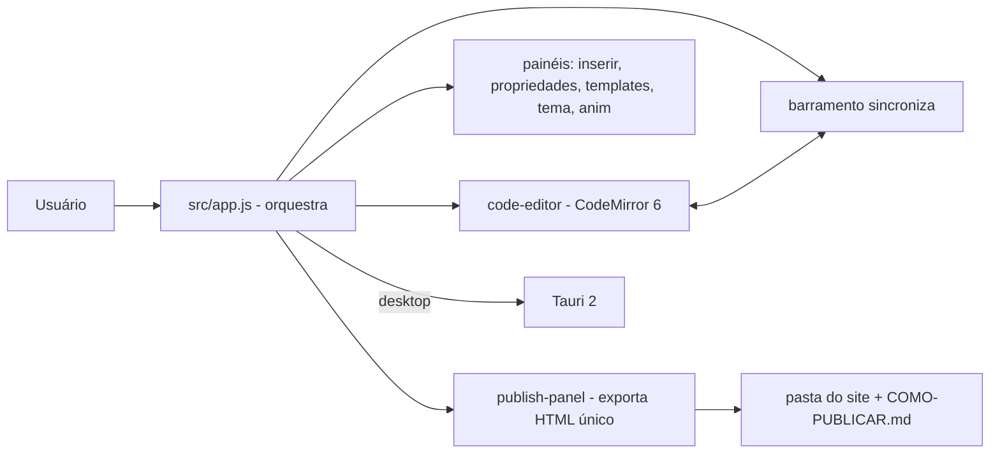

# olaria

[English](README.en.md) · **Português (Brasil)**

[](#) [](#) [](#) [](#) [](#) [](LICENSE)

## O que é

**Olaria** é um **construtor de landing pages** para pessoas **não técnicas**: crie uma página visualmente (clique, arraste, edite o texto) e veja o mesmo documento em código. A saída é **um arquivo HTML único**, pronto para publicar no GitHub Pages. É um app desktop (Tauri) com a mesma interface rodando no navegador em modo de teste.

> Nota: o README anterior descrevia um **dashboard financeiro** (Recharts, assistente IA) — não existe neste repositório. Corrigido.

## Status

Em produção, versão **0.3.0** (compilada e testada). Possui binário desktop (Releases). Build web e testes validados pelo agente.

## Funcionalidades

- **4 visões do mesmo documento**: Editar (canvas), Visualizar (como o visitante vê), Código e Dividido (canvas + editor).
- **Edição visual**: clique seleciona, arrastar move, duplo clique edita texto, painel de propriedades à direita.
- **Editor de código**: CodeMirror 6 (HTML/CSS/JS), sempre sincronizado com o canvas.
- **Inserção de blocos**: painel de inserção e templates de página.
- **Tema e animação**: painéis de tema e de animações.
- **Publicação**: exporta **HTML de arquivo único** e gera uma pasta do site com `COMO-PUBLICAR.md` (para GitHub Pages).
- **Undo/redo** e persistência.
- **App desktop escuro de alto contraste** (decisão de ferramenta), sites criados com tema livre.

## Arquitetura

Frontend em JavaScript vanilla (sem framework) com um barramento de eventos (`bus`) central e módulos separados por funcionalidade. O shell desktop é Tauri 2 (Rust); o frontend roda igual no navegador em modo de teste de interface.



## Stack

- JavaScript ES6+ (vanilla, sem framework)
- CodeMirror 6 (editor)
- Vite 6 (build web), Vitest 5 + jsdom (testes)
- Tauri 2 (desktop: `@tauri-apps/api`, plugin-dialog)

## Estrutura do repositório

```
olaria/
├── src/
│   ├── app.js              # orquestração, undo/redo, eventos
│   ├── core/               # state, store, docutils, assets, ui
│   ├── modules/            # insert, props, templates, theme, anim, publish,
│   │                       # code-editor, preview, components
│   └── core/__tests__      # testes
├── scripts/                # make-icon, check-syntax
├── docs/contrato-templates.md
├── CONTEXTO.md             # handoff técnico do projeto
├── index.html · package.json · vite.config
└── LICENSE                 # MIT
```

## Pré-requisitos e instalação

Node.js (npm). Para o build desktop, [Rust + pré-requisitos do Tauri](https://tauri.app/start/prerequisites/).

```bash
git clone https://github.com/KelvinOliveiraCode/olaria.git
cd olaria
npm install
```

## Como executar

```bash
npm run dev          # interface no navegador (modo teste)
npm run build        # build web (validado pelo agente)
npm test             # vitest run
npm run tauri dev    # app desktop (Tauri 2)
npm run check        # checagem de sintaxe dos scripts
```

> A interface no navegador é o modo de teste; para abrir arquivos, pastas e publicar, use o app desktop instalado.

## Testes e qualidade

Execução real (verificada pelo agente):

```bash
npm test
# 119 passed (5 arquivos)
npm run build
# built in 2.37s
```

Não há CI configurado neste repositório.

## Decisões técnicas e trade-offs

- **HTML de arquivo único como saída**: o site gerado é facilmente publicável (GitHub Pages) e autocontido; sem build no lado do site.
- **Barramento de eventos em vez de framework**: acoplamento fraco entre canvas, editor e painéis, sem dependência de React/etc.
- **App escuro, sites livres**: a ferramenta de trabalho é escura por decisão; o site criado pode ter qualquer tema.
- **CodeMirror como editor**: mesma experiência de código (sintaxe HTML/CSS/JS) com sincronização imediata com o canvas.

## Limitações conhecidas e roadmap

- O modo navegador é de teste de interface; os recursos de arquivo/pasta/publicação exigem o app desktop.
- Templates cobrem um conjunto de blocos; novos blocos são adicionados via painel de inserção/templates.

## Processo de desenvolvimento

Projeto individual de Kelvin Oliveira, construído com agentes de IA orquestrados e revisado pelo autor. A arquitetura do builder, as decisões de produto registradas em `CONTEXTO.md` e a revisão são do autor.

## Licença e autor

MIT — Copyright (c) 2026 Kelvin Rebelo de Oliveira.

**Autor**: [Kelvin Oliveira](https://github.com/KelvinOliveiraCode) · [Portfólio](https://kelvinoliveiracode.github.io/portfolio/)
